# ilab-aibuilders-prototypes

Catálogo central de prototipos de inteligencia artificial aplicada para **Salud Digital (Telemedicina)** y **Finanzas Personales Bimonetarias (Quetzales `Q` y Dólares `$`)**, diseñados bajo una interfaz minimalista en modo claro, orientada al usuario final y desplegada en producción.

---

## Prototipos en Producción

| Proyecto | Dominio | Demo en Vivo | Repositorio | Capacidades Clave |
| :--- | :--- | :--- | :--- | :--- |
| **1. PreConsulta (Web)** | Salud Digital / Triaje | [**telemed-preconsult-ai.vercel.app**](https://telemed-preconsult-ai.vercel.app) | [`ykro/telemed-preconsult-ai`](https://github.com/ykro/telemed-preconsult-ai) | Captura por voz o texto, seguimiento adaptativo de **1 a 3 preguntas** (*"Ayúdame con más información"*), banner de alerta prioritaria de alta visibilidad y doble entregable (Paciente + Nota SOAP médica). |
| **1B. PreConsulta (Android Nativo)** | Salud Digital / Edge AI | *APK Nativo Android* | [`ykro/telemed-preconsult-android`](https://github.com/ykro/telemed-preconsult-android) | Cliente nativo en Kotlin + Jetpack Compose con inferencia local **Gemma 4 E2B** (MediaPipe) para zonas sin conectividad y respaldo hacia **Gemini 3.8 Flash**. |
| **2. Estabilizador de Ingresos** | Finanzas / Ingresos Variables | [**freelance-cashflow-smoother.vercel.app**](https://freelance-cashflow-smoother.vercel.app) | [`ykro/freelance-cashflow-smoother`](https://github.com/ykro/freelance-cashflow-smoother) | Presupuesto para trabajadores independientes o informales: aprende de tus **meses o semanas buenas y malas** y calcula **cuánto apartar cada semana** para no quedarte sin dinero en temporada baja. Pantallas separadas de captura y resultado, soporte simultáneo en `Q` y `$`, y simulador de baja (`-50%`) o alta (`+50%`). |
| **3. Inteligencia de Estados de Cuenta** | Finanzas / Estados de Cuenta PDF | [**card-statement-insights.vercel.app**](https://card-statement-insights.vercel.app) | [`ykro/card-statement-insights`](https://github.com/ykro/card-statement-insights) | Lector directo de estados de cuenta bancarios en PDF con soporte **bimonetario simultáneo (`Q` + `$` + `Extrafinanciamientos`)**, pantallas separadas de carga y **Dashboard Ejecutivo gráfico**, identificación de tendencias a 3 meses e **Información para decidir** con ahorro cuantificado. |

---

## Arquitectura del Ecosistema

### Patrón de Interacción: Captura y Decisión Desacopladas

---

## Detalle por Proyecto

### 1. PreConsulta — Triaje Clínico Asistido (`telemed-preconsult-ai` & `telemed-preconsult-android`)
- **Problema que resuelve:** Reduce el tiempo de interrogatorio inicial en telemedicina organizando los síntomas del paciente antes de entrar con el médico y detectando signos de alarma de forma temprana.
- **Flujo de 3 pasos:**
  1. **Motivo de consulta:** Dictado por voz (Web Speech API `es-GT`) o escritura libre, más signos vitales opcionales (`Temperatura`, `SpO2`, `Frecuencia cardíaca`, `Presión arterial`).
  2. **Ayúdame con más información:** Generación dinámica de **1 a 3 preguntas puntuales** según la información clínica faltante.
  3. **Resumen y Acción Recomendada:** Banner prioritario de alta visibilidad en la parte superior (*"Consulta prioritaria hoy: Tu oxigenación de 96% es estable; si baja de 92% o tienes dificultad para respirar, acude a urgencias."*) acompañado de la guía para el paciente y la **Nota SOAP** estructurada para el médico.

### 2. Estabilizador — Presupuesto para Ingresos Variables (`freelance-cashflow-smoother`)
- **Problema que resuelve:** Para trabajadores informales, comerciantes o freelancers cuyos ingresos suben y bajan drásticamente: analiza su historial reciente, distingue meses o semanas buenas y malas, y calcula **cuánto apartar cada semana** para mantener un ingreso seguro en temporada baja.
- **Diseño en dos pantallas:**
  1. **Configuración de ingresos y gastos (Input):** Selector **Modo Mes / Modo Semana**, registro simultáneo de ingresos y gastos esenciales en **Quetzales (`Q`) y Dólares (`$`)**, y clasificación automática de cada período (*Temporada Alta*, *Normal*, *Temporada Baja*).
  2. **Plan semanal y proyección (Output):** Cuota exacta a apartar esta semana, sueldo seguro semanal/mensual, desglose bimonetario (`Q` + `$`) y gráfica interactiva **Ingreso Real vs. Sueldo Estabilizado** con simulador desde **`-50%` (Temporada Baja)** hasta **`+50%` (Temporada Alta)**.

### 3. Estados de Cuenta — Inteligencia para Decidir (`card-statement-insights`)
- **Problema que resuelve:** Transforma estados de cuenta bancarios en PDF (desde 1 archivo para radiografía inmediata hasta 3+ meses para identificación de tendencias) en un tablero visual de decisiones financieras.
- **Diseño en dos pantallas:**
  1. **Carga de estados de cuenta PDF (Input):** Extracción ultrarrápida (`<50 ms`) de flujos PDF bancarios (`FlateDecode`), separando automáticamente **Movimientos en Quetzales (`Q`)**, **Movimientos en Dólares (`$`)** y **Cuotas / Extrafinanciamientos**.
  2. **Dashboard Ejecutivo (Output):**
     - **Información para decidir:** Decisiones concretas con evidencia del estado de cuenta e impacto mensual estimado en `Q` y `$`.
     - **Tendencias a 3 meses:** Velocidad de crecimiento por categoría, frecuencia de comercios recurrentes, gastos hormiga y peso de cuotas frente al consumo corriente.

---

## Estándares de Diseño e Ingeniería

- **Interfaz 100% Modo Claro y Minimalista:** Paleta editorial limpia, sin paneles oscuros, sin emojis y sin jerga técnica expuesta al usuario final.
- **Bimonetario Simultáneo Real (`GTQ Q` + `USD $`):** Los productos financieros operan con ingresos, gastos y consumos en Quetzales y Dólares al mismo tiempo, reflejando la realidad bancaria y laboral de Guatemala y Latinoamérica.
- **Despliegue Continuo:** Repositorios conectados a Vercel con despliegue automático de producción desde la rama `main`.
